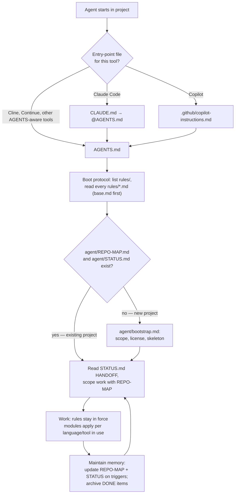

# Agent contract — rationale

This directory explains **why** the rules in `rules/` exist. The rule files are the contract
agents must follow; these pages are the reasoning behind it, written for the humans who
maintain the ruleset and review agent output — and for agents only when explicitly asked.

> Not agent boot material. Nothing here is read during the session-start protocol;
> `AGENTS.md` sends agents to `rules/`, never here. Keeping the "why" out of the boot path
> keeps agent context small (see base-contract.md, Context discipline).

## How the contract fits together



Plain-text version (for non-rendering contexts):

```
agent starts
  └─ entry point: CLAUDE.md / .github/copilot-instructions.md → AGENTS.md
       └─ boot: list rules/ → read every rules/*.md, base.md first
            ├─ no agent/REPO-MAP.md or STATUS.md → agent/bootstrap.md (new-project protocol)
            └─ exists → read STATUS.md HANDOFF, scope via REPO-MAP
                 └─ work under the rules
                      └─ update REPO-MAP + STATUS on triggers; archive DONE items → loop
```

## Memory files vs. this directory

`agent/project_layout.md` describes the layout of a **project using** this contract (its
`docs/` holds that project's own documentation). This `docs/` belongs to the **contract
itself** and travels with it when copied into a project; treat it as read-only reference
material, listed in REPO-MAP but never edited by agents (base.md, Rule files).

## Rationale pages

| Page | Rules it explains |
|---|---|
| [base-contract.md](base-contract.md) | `rules/base.md` — context discipline, externalized memory, HANDOFF, archiving, rule-file protection |
| [verification.md](verification.md) | `rules/verification.md`, Enforcement in `rules/adr.md` — claims become checks; the IaC test ladder (static → rendered → check mode → idempotency → lab → canary) |
| [memory-and-bootstrap.md](memory-and-bootstrap.md) | `agent/bootstrap.md`, `agent/project_layout.md`, REPO-MAP/STATUS lifecycle |
| [tooling-and-modules.md](tooling-and-modules.md) | `rules/python.md`, `rules/terraform_tfgrunt.md`, `rules/ansible.md`, `rules/web.md` — why the per-tool modules read as checklists, and the pin / declare-intent / fail-loudly pattern underneath them |

## Reading order for a new colleague

1. `AGENTS.md` (30 seconds — the boot protocol).
2. `rules/base.md` — the always-on contract.
3. This page, then base-contract.md — why it is shaped this way.
4. Skim the tool modules you expect to use; they are short and self-contained.
5. Copy the whole directory into a fresh project, open it with any agent, and run bootstrap.