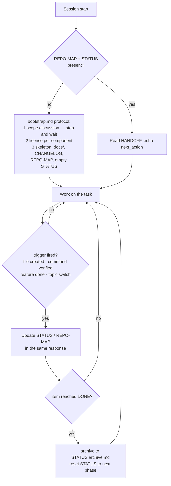

# Memory files and bootstrap: the project lifecycle

Companions to `agent/bootstrap.md`, `agent/project_layout.md` and the memory sections of
`rules/base.md`. Start at [index.md](index.md).

## The lifecycle the agent files implement

## Why bootstrap asks instead of scaffolding everything

A tool-generated project skeleton reflects the generator's assumptions, not the project's.
The protocol therefore front-loads one human conversation (goal, scope, non-goals) and builds
only what that answer justifies — a design-first project gets `docs/`, a small script does not.
The stop-and-wait after the scope question is deliberate: agents that "propose and proceed"
in one breath produce scaffolding the user never agreed to.

## License first, per component

Licensing is treated as a bootstrap step rather than a footer task because it constrains what
may be copied in at all — decided before dependencies exist, when changing your mind is free.
The per-component rule (templates or generated artifacts can carry different terms than the
code) exists because administrative and infrastructure projects routinely mix: a report
template meant for redistribution should not inherit a proprietary code license, and vice
versa. The license files in `licenses/` travel with the contract precisely so the question is
answerable at the moment it is asked.

## Why bootstrap writes an empty STATUS.md

Creating STATUS.md with zero content is the trick that makes the whole memory system
self-enforcing: from the first session onward, every session start finds the file and follows
the update triggers. A project where STATUS appears "later, when there is something to report"
is a project where nobody remembers to create it.

## REPO-MAP as the anti-hallucination index

Two failure modes motivated the explicit index instead of letting agents explore:

- **Invented structure.** Without an authoritative map, an agent asked about `src/` may
  describe the layout it *expects* rather than the one that exists. The map is ground truth,
  and "would another agent need to know this file exists?" is its inclusion test.
- **Wandering.** Repo-wide searches at session start are expensive and mostly irrelevant;
  an index turns orientation into one read. Hence the staleness rule — an unmaintained map is
  worse than none, because agents trust it.

## Excluding artifacts from the index

The exclusion list (`.venv`, `__pycache__`, build outputs, git-ignored files) keeps the map a
map of *intent*. Once generated content enters the index, the anti-wandering property dies:
agents will faithfully read into a virtualenv because the index said it was relevant.

## Real-world failure modes these files prevent

| Without this… | Failure observed in practice |
|---|---|
| Bootstrap scope question | Agent scaffolds a full framework for what was a 50-line script |
| Empty STATUS at bootstrap | Session 2 starts blind and redoes session 1's decisions |
| HANDOFF schema | "Notes" become essays; next session guesses the first action wrong |
| Archive trigger | STATUS grows to 300 lines; agent treats phase-1 tasks as live work |
| REPO-MAP staleness rule | Agent edits a deleted file for hours because the index still lists it |
