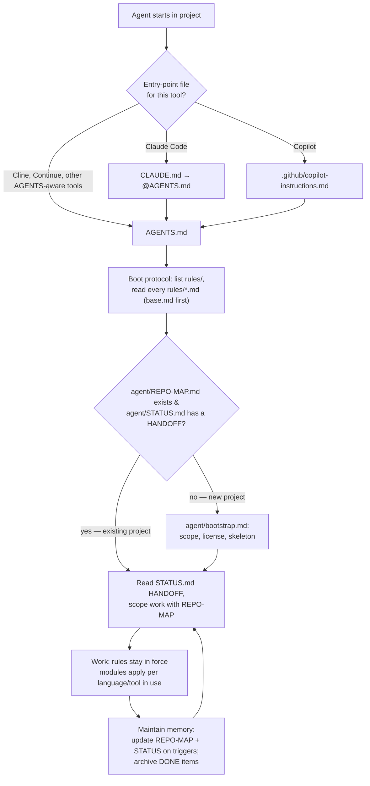

**Bringing order to your agents.** 🧹

Every AI coding agent starts your project as a brilliant amnesiac: great at the task in front
of it, hopeless at remembering why you do things this way — until the next session wipes the
slate clean. **Ordnung is the cure**: drop-in *agent contracts* that give a generic agent a
role, a working discipline, and a memory system written to files instead of chat history. The
agent may forget; Ordnung does not.

Each contract is a self-contained folder you copy into your project root. It turns the same
generic agent into a specialist — an infrastructure designer, an administrative assistant —
and keeps it coherent across sessions without you babysitting.

The contracts are **agent-agnostic**: the same files drive Copilot, Claude Code, Cline,
Continue, Cursor or any tool that reads `AGENTS.md`. They were shaped against small local
models (Qwen, DeepSeek), where explicit rules and externalized state are not a nicety but the
only way to keep sessions coherent.

## Bring your own persona 🤝

Ordnung is built to grow: **your take on an agent contract is welcome here.** Maybe you have a
discipline for data-science notebooks, homelab operations, or legal drafting that actually
keeps an agent honest. The framework gives you the hard parts up front — the shared core
(boot protocol, HANDOFF continuity, verification discipline), guides for writing rules and
rationale, and tooling (`tools/check_sync`, `tools/new_persona`) that scaffolds a new persona
and keeps its shared sections from drifting against the others. You bring the specialist
flavor; the repo keeps everyone's copy honest. Start at
[CONTRIBUTING.md](CONTRIBUTING.md) — it walks through the whole process.

## What is in the repo

| Contract | Role | Specialist modules |
|---|---|---|
| [`contracts/persona/iac/`](contracts/persona/iac/) | IT infrastructure designer & administrator | Terraform/Terragrunt, Ansible, Python, web |
| [`contracts/persona/administrative/`](contracts/persona/administrative/) | Administrative assistant (quotes, invoices, bookkeeping, correspondence) | Financial integrity, document lifecycle, approval classes, Python data scripting |

Both share the same transferable core: session boot protocol, externalized memory, HANDOFF
continuity, verification discipline, decision records. The decision-record naming follows the
persona: `contracts/persona/iac/` uses **ADRs** (`rules/adr.md`, `docs/adr/`) because "architecture" is literal
there and the convention matches existing projects; `contracts/persona/administrative/` uses plain **DRs**
(`rules/dr.md`, `docs/decisions/`) — the decision discipline applies, the architecture framing
does not.

## Anatomy of a contract

```
<contract>/
├── AGENTS.md                        ← single source of truth: the boot protocol
├── CLAUDE.md                        ← one line: load @AGENTS.md (Claude Code entry)
├── .github/copilot-instructions.md  ← same pointer, for Copilot
├── rules/
│   ├── base.md                      ← always-on contract (role, memory, discipline)
│   └── <module>.md                  ← loaded when that language/tool/domain is in use
├── agent/
│   ├── bootstrap.md                 ← new-project protocol (scope → license → skeleton)
│   ├── project_layout.md            ← what a bootstrapped project looks like
│   └── STATUS.md                    ← format spec for the agent's session memory
├── docs/agent-contract/             ← WHY the rules exist (human rationale — never read at boot)
└── licenses/                        ← license texts bootstrap picks from
```

The pointer files (`CLAUDE.md`, `copilot-instructions.md`) contain no rules — they only send
every tool to `AGENTS.md`, which dictates where the rules live. One contract, many entry points.

## How the flow works



Plain-text version (for non-rendering contexts):

```
agent starts
  └─ entry point: CLAUDE.md / .github/copilot-instructions.md → AGENTS.md
       └─ boot: list rules/ → read every rules/*.md, base.md first
            ├─ no REPO-MAP, or STATUS is empty template → agent/bootstrap.md (new-project protocol)
            └─ exists → read STATUS.md HANDOFF, scope via REPO-MAP
                 └─ work under the rules
                      └─ update REPO-MAP + STATUS on triggers; archive DONE items → loop
```

The design idea in one sentence: **durable state lives in files, not in conversation history** —
`agent/REPO-MAP.md` is what exists, `agent/STATUS.md` is what is happening, the rules are how
the agent behaves; the chat is disposable.

## Using a contract in a project

1. **Copy** the contract folder (e.g. `contracts/persona/administrative/`) into the project root.
2. **Open the project with any agent.** The tool's entry-point file sends it to `AGENTS.md`,
   which makes the agent read all of `rules/` before doing anything else.
3. **First session runs bootstrap**: the agent asks about goal and scope, settles licensing,
   creates the project skeleton and `agent/REPO-MAP.md`, and fills the shipped empty
   `agent/STATUS.md` template with its first HANDOFF. Everything after that is the loop in the
   diagram above. (Bootstrap recognizes itself by content: no REPO-MAP, or a STATUS.md without
   a written HANDOFF, means it has not run yet.)

The contract folder itself is read-only for agents: rule files may only change when you
explicitly ask for that specific change.

## Editing a contract

This repository **runs its own contract**: the root folder is the `repo-maintainer` persona
(`AGENTS.md`, `rules/`, `agent/`), and agents working here follow the same boot protocol they
ship. That self-hosting is deliberate — the sync problems these contracts police are the ones
the repo would otherwise suffer itself.

- Shared behavior between personas is marked with inline seams (`<!-- core -->`,
  `<!-- slot: name -->`, `<!-- persona -->`) and enforced by `tools/check_sync` — see
  [docs/authoring/core-sync.md](docs/authoring/core-sync.md). A commit that changes a core
  section changes it in every persona and the root copy, in that same commit.
- Adding a persona? Follow [docs/authoring/persona-anatomy.md](docs/authoring/persona-anatomy.md).
- Rules are **generic** — no project-specific names, paths or numbers; those belong in each
  project's REPO-MAP/STATUS.
- Keep the pattern: `base.md` carries what every session needs; modules stay short, imperative
  checklists for their domain; the *why* goes in `docs/agent-contract/`, never into boot material.
- When you change a rule, update its rationale page in `docs/agent-contract/` in the same commit.
- Keep pointer files dumb: they point at `AGENTS.md` and contain nothing else.

## Checks

```sh
python3 tools/check_sync            # seam structure + core drift (personas + root copy)
uv run --with pytest --no-project python -m pytest tests/ -q   # checker self-tests
```

Both must pass before committing contract or tooling changes.

## Where to read more

- Want to add a persona? [CONTRIBUTING.md](CONTRIBUTING.md), then
  [docs/authoring/persona-anatomy.md](docs/authoring/persona-anatomy.md).
- Each contract explains itself in detail under `docs/agent-contract/`:

- [IaC rationale](contracts/persona/iac/docs/agent-contract/index.md) — base contract, verification/test ladder,
  bootstrap lifecycle, tooling modules.
- [Administrative rationale](contracts/persona/administrative/docs/agent-contract/index.md) — base contract,
  verification/records ladder, bootstrap lifecycle, financial integrity & approval classes.