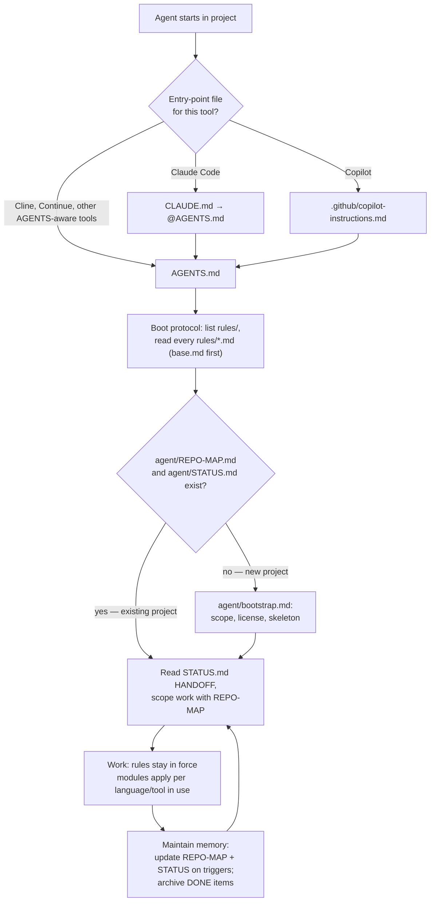

# AI Agent Rulesets

Role-specific **agent contracts**: each folder turns a generic coding agent into a specialist —
an infrastructure designer, an administrative assistant — by giving it a role, working
discipline, and a memory system it can run across sessions without supervision.

The contracts are **agent-agnostic**: the same files drive Copilot, Claude Code, Cline,
Continue, Cursor or any tool that reads `AGENTS.md`. They were shaped against small local
models (Qwen, DeepSeek), where explicit rules and externalized state are not a nicety but the
only way to keep sessions coherent.

## What is in the repo

| Ruleset | Role | Specialist modules |
|---|---|---|
| [`IaC/`](IaC/) | IT infrastructure designer & administrator | Terraform/Terragrunt, Ansible, Python, web |
| [`administrative/`](administrative/) | Administrative assistant (quotes, invoices, bookkeeping, correspondence) | Financial integrity, document lifecycle, approval classes, Python data scripting |

Both share the same transferable core: session boot protocol, externalized memory, HANDOFF
continuity, verification discipline, decision records.

## Anatomy of a ruleset

```
<ruleset>/
├── AGENTS.md                        ← single source of truth: the boot protocol
├── CLAUDE.md                        ← one line: load @AGENTS.md (Claude Code entry)
├── .github/copilot-instructions.md  ← same pointer, for Copilot
├── rules/
│   ├── base.md                      ← always-on contract (role, memory, discipline)
│   └── <module>.md                  ← loaded when that language/tool/domain is in use
├── agent/
│   ├── bootstrap.md                 ← new-project protocol (scope → license → skeleton)
│   ├── project_layout.md            ← what a bootstrapped project looks like
│   └── STATUS.md                    ← format spec for the agent's session memory
├── docs/agent-contract/             ← WHY the rules exist (human rationale — never read at boot)
└── licenses/                        ← license texts bootstrap picks from
```

The pointer files (`CLAUDE.md`, `copilot-instructions.md`) contain no rules — they only send
every tool to `AGENTS.md`, which dictates where the rules live. One contract, many entry points.

## How the flow works



Plain-text version (for non-rendering contexts):

```
agent starts
  └─ entry point: CLAUDE.md / .github/copilot-instructions.md → AGENTS.md
       └─ boot: list rules/ → read every rules/*.md, base.md first
            ├─ no agent/REPO-MAP.md or STATUS.md → agent/bootstrap.md (new-project protocol)
            └─ exists → read STATUS.md HANDOFF, scope via REPO-MAP
                 └─ work under the rules
                      └─ update REPO-MAP + STATUS on triggers; archive DONE items → loop
```

The design idea in one sentence: **durable state lives in files, not in conversation history** —
`agent/REPO-MAP.md` is what exists, `agent/STATUS.md` is what is happening, the rules are how
the agent behaves; the chat is disposable.

## Using a ruleset in a project

1. **Copy** the ruleset folder (e.g. `administrative/`) into the project root.
2. **Open the project with any agent.** The tool's entry-point file sends it to `AGENTS.md`,
   which makes the agent read all of `rules/` before doing anything else.
3. **First session runs bootstrap**: the agent asks about goal and scope, settles licensing,
   and creates the project skeleton plus its memory files (`agent/REPO-MAP.md`,
   `agent/STATUS.md`). Everything after that is the loop in the diagram above.

The ruleset folder itself is read-only for agents: rule files may only change when you
explicitly ask for that specific change.

## Editing a ruleset

- Rules are **generic** — no project-specific names, paths or numbers; those belong in each
  project's REPO-MAP/STATUS.
- Keep the pattern: `base.md` carries what every session needs; modules stay short, imperative
  checklists for their domain; the *why* goes in `docs/agent-contract/`, never into boot material.
- When you change a rule, update its rationale page in `docs/agent-contract/` in the same commit.
- Keep pointer files dumb: they point at `AGENTS.md` and contain nothing else.

## Where to read more

Each ruleset explains itself in detail under `docs/agent-contract/`:

- [IaC rationale](IaC/docs/agent-contract/index.md) — base contract, verification/test ladder,
  bootstrap lifecycle, tooling modules.
- [Administrative rationale](administrative/docs/agent-contract/index.md) — base contract,
  verification/records ladder, bootstrap lifecycle, financial integrity & approval classes.