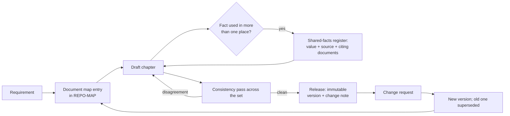

# The document set: memory for multi-chapter work

Companion to `rules/documents.md`, `agent/bootstrap.md` and `agent/project_layout.md`. Start at
[index.md](index.md).

## The problem this module exists for
Complex work spans chapters and documents: a segmentation design with per-site chapters, a
five-product comparison with a scoring appendix, a migration programme with an advisory per phase.
Agent context is not a memory - it compacts, it drifts, and it is gone next session. Code gets a
repository, a changelog and tests for exactly this reason. `rules/documents.md` gives prose the same
treatment: a document map, registers, and a lifecycle.

## Why registers, and not prose
The registers - documents, shared facts, terminology, sources, open items - live in
`agent/REPO-MAP.md` because that file is already the boot read: every agent reads it, the update
triggers maintain it, and it is where the other personas keep their number sequences and master data.
A register entry makes a fact checkable: value, source, which documents cite it. The same fact
repeated in six chapters is uncheckable, and six drifting copies is the normal outcome.

The shared-facts register is the entry with teeth. "The Enterprise licence price" appears in the
comparison, in the advisory and in the design's cost section. With a register, one edit propagates
and the consistency pass proves it. Without one, three documents drift apart and the reader finds the
disagreement first - usually in a meeting.

## Why five lifecycle states, and immutability after release
"Released is immutable" is imported from records work for the same reason: a document is evidence of
what was decided, on what basis, and by whom. Editing a released comparison quietly rewrites that
evidence - the reader who acted on v1.0 cannot tell that the table they relied on changed. A new
version citing the original preserves both the correction and the audit trail.

## Why bootstrap asks the format question early
Format decides the toolchain, the figure formats, the table widths and the review channel. Asked
after three chapters exist, the answer is always "keep Markdown, and also produce Word" - which from
that point is two documents to maintain, and one source of truth lost.

## Failure modes these files prevent

| Without this | Failure observed in practice |
|---|---|
| Document map | Two drafts of the same design, both labelled current; the reader gets the older one |
| Shared-facts register | The summary quotes the figure cut in the last edit; the body says otherwise |
| Terminology register | "VLAN", "segment" and "broadcast domain" used as synonyms in a design an auditor reads |
| Source register | A citation with no retrieval date; the vendor page changed, and the claim is now unprovable |
| Open-items register | The recommendation rests on an assumption nobody agreed to, discovered at the steering meeting |
| Immutability after release | The comparison a purchase decision was made against no longer exists |
| Version in filename and header | "final-v3-FINAL" copies multiplying in the mail folder |
| Consistency pass over the set | Chapter 4 recommends what chapter 2 rejected |