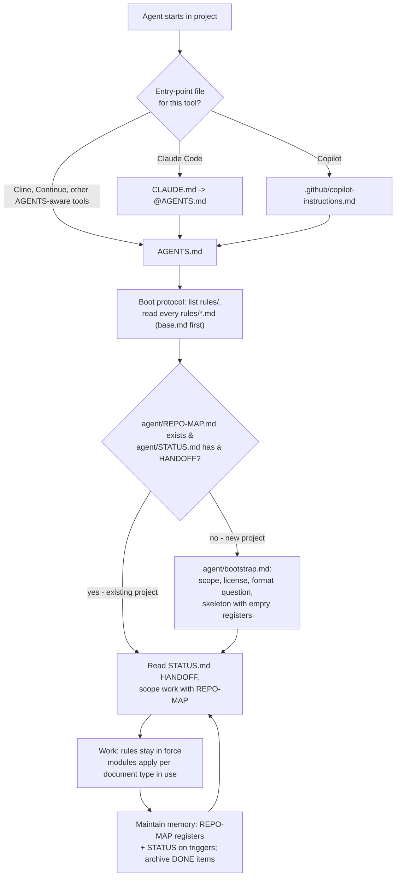

# Agent contract - rationale

This directory explains **why** the rules in `rules/` exist. The rule files are the contract
agents must follow; these pages are the reasoning behind it, written for the humans who maintain
this contract and review agent output - and for agents only when explicitly asked.

> Not agent boot material. Nothing here is read during the session-start protocol; `AGENTS.md`
> sends agents to `rules/`, never here.

## How the contract fits together



Plain-text version (for non-rendering contexts):

```
agent starts
  |-- entry point: CLAUDE.md / .github/copilot-instructions.md -> AGENTS.md
  |-- boot: list rules/ -> read every rules/*.md, base.md first
       |-- no REPO-MAP, or STATUS is empty template -> agent/bootstrap.md (new-project protocol)
       |-- exists -> read STATUS.md HANDOFF, scope via REPO-MAP
            |-- work under the rules
            |-- update REPO-MAP registers + STATUS on triggers; archive DONE items -> loop
```

## What this persona adds to the shared core

The core (context discipline, REPO-MAP, STATUS, archiving, rule-file protection) is shared with the
other personas byte for byte. What is specific here is the object being maintained: not code, not
records, but **documents that someone must act on**. The persona modules exist because the failure
modes of document work are specific: a confident sentence about a product feature that does not
exist, a comparison written from one vendor's marketing, an assumption buried in prose, a diagram
that nobody asked for, a Word file hand-shaped from Markdown, and a six-document set where chapter 3
quietly disagrees with chapter 1.

## Rationale pages

| Page | Rules it explains |
|---|---|
| [base-contract.md](base-contract.md) | `rules/base.md` - the decision-support role, why the format and audience questions are mandatory, rule-file protection |
| [document-set-and-memory.md](document-set-and-memory.md) | `rules/documents.md`, `agent/bootstrap.md`, `agent/project_layout.md` - lifecycle states, and why multi-chapter work is tracked in registers instead of context |
| [comparisons-and-advisories.md](comparisons-and-advisories.md) | `rules/comparisons.md`, `rules/advisories.md`, `rules/verification.md`, `rules/dr.md` - evidence for external claims, fairness pass, why a tick matrix is not a verdict |
| [format-and-visuals.md](format-and-visuals.md) | `rules/output_formats.md`, `rules/visuals.md` - why the agent may not pick a format, why generated output is code, when a figure beats a sentence |
| [open-items-and-ideas.md](open-items-and-ideas.md) | `rules/open_questions.md` - the no-silent-assumptions rule, and the list of further ideas this persona could grow into |

## Reading order for a new colleague

1. `AGENTS.md` (30 seconds - the boot protocol).
2. `rules/base.md` - the always-on contract.
3. This page, then base-contract.md - why it is shaped this way.
4. The modules for the document types you expect to write; they are short and self-contained.
5. Copy the whole directory into a fresh project, open it with any agent, and run bootstrap.